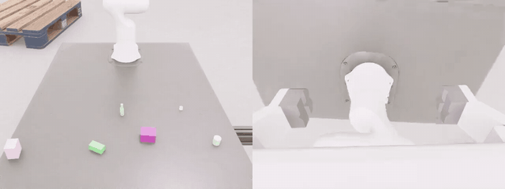

# automate-datagen

**Single-arm assembly data pipeline on Isaac Lab AutoMate.**

<p align="center"></p>
<p align="center"><sub>Task 00768 · front D435 (left) and wrist D405 (right) · 2× speed<br>
Full-resolution clips: <a href="docs/media/demo_00768.mp4">00768</a> · <a href="docs/media/demo_00016.mp4">00016</a> · <a href="docs/media/demo_00293.mp4">00293</a></sub></p>

A Franka Panda picks a plug up from the table, carries it to the socket, inserts it with a learned policy, releases it and returns home.
Every episode is recorded from two cameras (RGB + depth) with full per-frame state, and exported to **LeRobot v3**.

This repository is the code that produced the dataset `automate_fullproc_20261004`, plus a small sample of it.
It also lists, honestly, what we fixed along the way ([`docs/FIXES.md`](docs/FIXES.md)) and what is still open ([`docs/KNOWN_ISSUES.md`](docs/KNOWN_ISSUES.md)).

## The dataset at a glance

| | |
|---|---|
| Robot | Franka Panda + parallel gripper |
| Tasks | 85 AutoMate plug–socket assemblies |
| Episodes | 85 × 1,200 = **102,000**, successful only |
| Length | 30 fps, 25.4 s per episode on average, **719 h per camera** |
| Cameras | front D435 + wrist D405, 640×480 RGB + depth |
| Format | LeRobot v3 + diversity metadata (`ourdata-diversity-1.1`) |
| Size | 5.1 TB (not hosted here; see [Sample](#sample)) |
| Checks | full QC, content-hash dedup, external validator 85 / 85 |

## What happens in an episode

| phase | | controller | median frames |
|---:|---|---|---:|
| 0 | approach + soft-landing descent | script | 259 |
| 1 | grasp | script | 66 |
| 2 | lift | script | 54 |
| 3 | carry + align | script | 188 |
| 4 | insert | **PPO policy** (one per task) | 53 |
| 5 | release | script | 15 |
| 6 | return home | script | 121 |

- Plug and socket both stand on the table; gravity is on; there is no attachment assist.
- Socket: ±5 cm, 0–10° around its training pose.
- Plug: x ∈ [0.40, 0.75] m, y ∈ [−0.32, 0.32] m, ≥ 15 cm from the socket, yaw ±45°.

**Success.** Only successful episodes are kept.

- `keypoint`: mean keypoint error < 3 mm after insertion and still < 3 mm at the last frame.
- `deeper_ok`: for three assemblies with no physical stop at the goal. The target must be reached before the release; at the end the plug may sit deeper, but at most 3 mm out, 3 mm off-axis and 5° tilted.

The rule used is stored in every episode.

## Sample

[`sample/`](sample/franka_panda_single_arm) holds 5 tasks × 5 episodes (28 MB), in exactly the released format.

- **RGB only.** The sample is exported with `--no-depth` to stay small, so it has no depth sidecar (`depth_present: false`). The full dataset has depth for every frame.
- **Coverage.** Default rule (00016, 00293, 00768), `deeper_ok` (00007), raised grasp (00186), both randomization versions.
- **Checked.** All five pass the structural check and the external validator.

## Pipeline

```
train one PPO insertion policy per task                     scripts/training/
        │
collect     run_worker.sh → collect_queue.sh → collector    scripts/data_pipeline/
        │     overexposure filter runs alongside; collectors top up what it removes
        │
finalize    leftovers → last filter pass → top-up → trim to N → audit → QC
        │
export      LeRobot v3 per task → structural check → external validator
```

A few design rules hold throughout:

- **Nothing is deleted silently.** Rejected episodes move to `_quarantine/<reason>/`. The only deletion is the trim to N per task, and it writes a manifest first.
- **No seed or layout is reused.** Runs claim seeds from a global ledger; episode indices are claimed permanently.
- **Every rule is recorded.** Success rule, grasp raise, randomization version and all applied visual parameters are stored per episode.

### Visual randomization

| part | what varies |
|---|---|
| lighting | dome light intensity and tint; one sphere key light per env (intensity, radius, position) |
| distractors | 0–4 visual-only boxes / cylinders on the table |
| surfaces | table: palette colour or texture (50 / 50); floor texture |
| scene props | 3–6 warehouse props 2–6 m in front of the camera |

Episodes washed out by strong light are filtered automatically (first-frame table brightness). Exact ranges are in [`visual_randomization_mixed.json`](roboassemblybench/scripts/data_pipeline/visual_randomization_mixed.json).

### Exported features

| key | content |
|---|---|
| `observation.state` | end-effector pose (xyz + wxyz) + gripper opening |
| `action` | next frame's absolute pose + gripper target |
| `policy_action` | raw insertion-policy output (0 outside phase 4) |
| `phase_index` | phase 0–6 |
| `observation.joint_*` | joint state, velocity, effort |
| `observation.contact_force` | finger and plug contact forces (N) |
| `observation.plug_pose`, `socket_pose`, `keypoint_error` | object poses and goal error |
| `observation.images.front`, `.wrist` | H.264 video, raw streams concatenated, no re-encoding |

Depth is a sidecar under `sensors/depth/` (uint16 mm, chunked zstd). Read it with [`read_depth.py`](roboassemblybench/scripts/data_pipeline/read_depth.py).
`meta/diversity/` holds calibrations, per-episode environments, per-episode generation records and per-frame camera poses.

## Instruction labels

All 85 tasks share one action family (put a plug into or onto a socket), so the instruction label is assigned per task:
an action category plus target categories `[plug, socket]` from a controlled vocabulary.

- [`label_crops.py`](roboassemblybench/scripts/data_pipeline/label_crops.py) cuts 4 close-ups per task (plug and socket, side view of the mating, two wrist frames).
- [`vl_label.py`](roboassemblybench/scripts/data_pipeline/vl_label.py) asks a vision-language model (OpenAI-compatible API, `LLMAPI_*` settings) three times per task with the images shuffled.
- The majority answers were mapped to a controlled vocabulary and reviewed by hand: [`examples/instruction_labels_automate_fullproc_20261004.json`](examples/instruction_labels_automate_fullproc_20261004.json). 2 actions, 25 plug and 35 socket categories; 55 distinct labels over the 85 tasks (5.36 bit).

## Quick start

Requirements: Isaac Sim 5.1, Isaac Lab 2.3.2 (Python 3.11), rl_games, ffmpeg; pyarrow ≥ 17 for the exporter.

Nothing is tied to a machine: all paths are settings.

```bash
cp roboassemblybench/scripts/data_pipeline/config.example.env config.env   # edit the paths
set -a; source config.env; set +a
P=roboassemblybench/scripts/data_pipeline

python3 $P/build_task_list.py --dataset-root $DATASET_ROOT --tasks $TASK_CONFIG \
        --out $DATASET_ROOT/_queue/task_list_$QTAG.txt --preclaim          # 1. plan
bash $P/run_worker.sh <activate.sh> <GPU>                                 # 2. collect (one per GPU slot)
bash $P/overexposure_filter_loop.sh &                                     #    filter while collecting
bash $P/finalize.sh                                                       # 3. finalize
bash $P/export_queue.sh <worker name>                                     # 4. export (any number of hosts)
bash $P/status.sh summary
```

`<activate.sh>` is your own script that sets up Isaac Lab and defines `ISAACLAB`.
The task config used for the release is [`examples/tasks_automate_fullproc_20261004.txt`](examples/tasks_automate_fullproc_20261004.txt).

## Repository layout

```
roboassemblybench/
  library/automate/        Isaac Lab AutoMate v2.3.2 (vendored, BSD-3) + pick / collect environments
  datasets/                episode recorder
  scripts/
    collect_automate_single_arm.py   the collector
    training/                        per-task PPO training and evaluation
    data_pipeline/                   queue, workers, filter, trim, audit, QC, exporter, finalize, status
examples/                  task config and instruction labels of the release
sample/                    5 × 5 sample episodes (RGB only)
docs/                      FIXES.md, KNOWN_ISSUES.md, demo media
```

## About this code

The released dataset was produced with this code.
Afterwards the scripts were made machine-independent: paths became settings and ad-hoc analysis scripts were dropped. The cleaned versions were re-run against the dataset and in a collection smoke test.

## Credits

- AutoMate environments and assets: NVIDIA Isaac Lab (BSD-3-Clause), vendored at v2.3.2.
- Grew out of the RoboAssemblyBench project. The single-arm full-process pipeline, its fixes and the dataset are by Markwcl2004.
